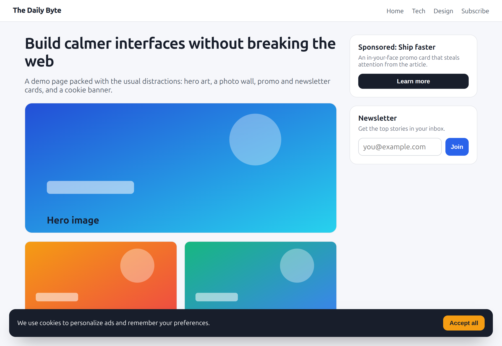
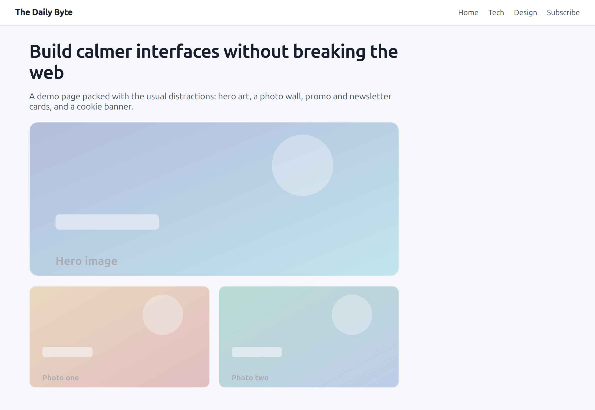
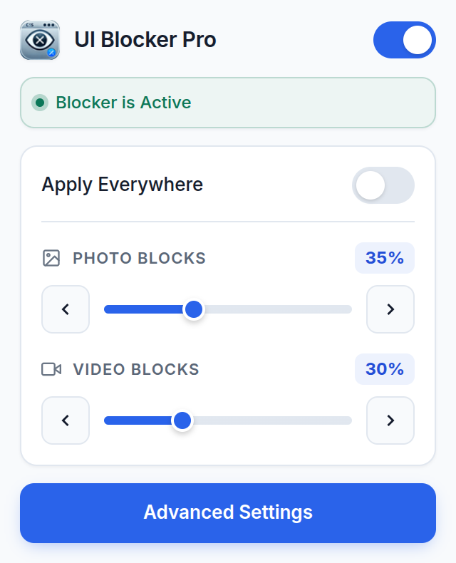
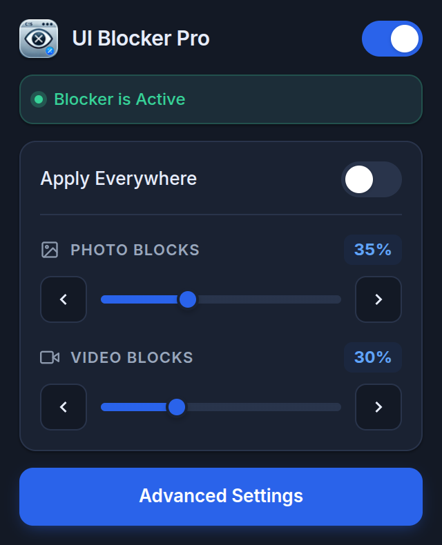
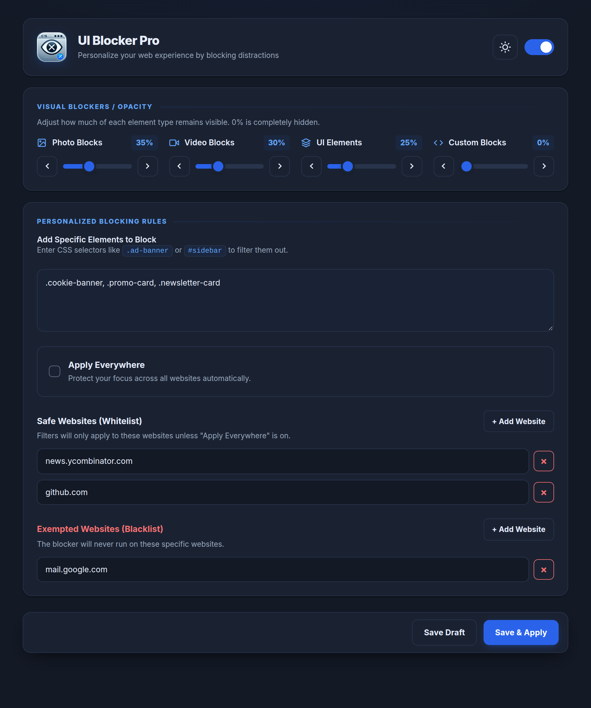
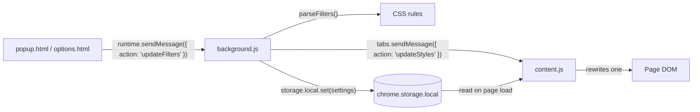

<div align="center">
  
  <h1>UI Blocker Pro</h1>
  <p><strong>Fade, hide and declutter any UI element on any website — without breaking the page.</strong><br>
  Chrome &amp; Firefox extension · Manifest V3 · No tracking, no telemetry</p>
  <p>
    
    
    
    
    
  </p>
</div>

---

**UI Blocker Pro** is a free, cross-browser extension that **fades or hides visual noise** on any web page: cookie banners, sticky headers, autoplay videos, image walls, sidebars, promo cards. Instead of ripping elements out of the DOM (which breaks layouts and sites), it adjusts **CSS opacity**, so the page keeps working while you get a calmer reading experience.

Rules can apply everywhere or only to the domains you choose, and every element type gets its own opacity level.

## Contents

[Features](#features) · [Screenshots](#screenshots) · [Install](#install) · [Quick start](#quick-start) · [How it works](#how-it-works) · [Settings reference](#settings-reference) · [Privacy](#privacy-and-permissions) · [FAQ](#faq) · [Browser support](#browser-support) · [Developer guide](#developer-guide) · [Credits](#credits)

---

## Features

| Feature | What it does |
|---|---|
| **Photo blocks** | Fade every `` from 0% (hidden) to 100% (normal) |
| **Video blocks** | Dim `<video>` players without pausing or unmounting them |
| **UI elements** | Fade `<audio>`, `<iframe>`, `<svg>` and `<canvas>` as one group |
| **Custom blocks** | Target exact elements with CSS selectors, e.g. `.cookie-banner, #sidebar, [data-testid='promo']` |
| **Apply everywhere** | One switch to apply your rules to every site |
| **Per-domain rules** | Whitelist where rules run, and blacklist sites that must never be touched |
| **Live updates** | Slider changes are debounced (150 ms) and applied instantly, no reload |
| **Light and dark themes** | Follows the system theme by default; the settings page has a manual toggle |
| **Local-only settings** | Stored with `chrome.storage.local`; nothing is synced to a server |
| **Non-invasive** | Pure CSS opacity plus a short transition; no DOM removal, no request blocking |

### Why opacity instead of `display: none`?

Hiding elements outright breaks sticky layouts, lazy loaders and scroll anchoring, and it can make sites fight back. Opacity keeps every element in the layout tree: nothing shifts, nothing is blocked, and returning a slider to 100% restores the page exactly as it was.

---

## Screenshots

Real captures of the unpacked extension in Chrome, generated by the [screenshot pipeline](#screenshot-pipeline).

**Before / after.** Images fade to 35%, while the promo card, newsletter card and cookie banner (custom selectors at 0%) are hidden.

| Before | After |
|:---:|:---:|
|  |  |

**Toolbar popup** — power switch, status, Apply Everywhere toggle, photo/video sliders and a shortcut to Settings.

| Light | Dark |
|:---:|:---:|
|  |  |

**Settings page** — four opacity groups, custom selectors, whitelist/blacklist and Save &amp; Apply.

<p align="center">
  
</p>

<details>
<summary>Settings page in dark theme</summary>
<p align="center">
  
</p>
</details>

---

## Install

The extension is not on the Chrome Web Store or Firefox Add-ons yet — install it as a developer build. It takes about 30 seconds.

### Chrome, Edge, Brave or Opera

1. Clone or download this repository.
   ```sh
   git clone https://github.com/sandeshPatel06/ui-blocker-pro.git
   ```
2. Open `chrome://extensions` (or `edge://extensions`, `brave://extensions`, `opera://extensions`).
3. Enable **Developer mode**.
4. Click **Load unpacked** and select the repository folder.
5. Pin **UI Blocker Pro** to the toolbar.

After changing `popup.*`, `options.*`, `background.js` or `manifest.json`, press the reload button on the extension card. After changing `content.js`, reload the extension and the page.

### Firefox 121+

1. Open `about:debugging#/runtime/this-firefox`.
2. Click **Load Temporary Add-on…**.
3. Select `manifest.json` in the repository folder.

Temporary add-ons are removed when Firefox restarts; load it again after a restart. The manifest includes a `browser_specific_settings.gecko.id`, so the add-on can be signed for permanent installation later.

---

## Quick start

1. **Click the toolbar icon.** The popup shows the global switch, the current status and sliders for photo and video blocks.
2. **Drag a slider.** Rules are applied live (150 ms debounce). “Apply Everywhere” decides whether they run on every site or only on your whitelist.
3. **Open Advanced Settings** for the full control panel: UI-element and custom-block opacity, CSS selectors, whitelist/blacklist and theme.
4. **Save & Apply** to persist to `chrome.storage.local` and push the new rules to every open tab.

To find a selector, right-click the annoying element and choose **Inspect**, then copy its class, id or a `data-*` attribute. Prefer stable hooks such as `#cookie-consent` or `[data-testid="promo"]` over hashed class names.

---

## How it works

The extension converts your settings into a small stylesheet and injects it into every matching page.

1. The popup or settings page sends an `updateFilters` message to the service worker.
2. The service worker builds CSS rules from your sliders, selectors and domains.
3. Rules are written to `chrome.storage.local`.
4. Every open tab receives an `updateStyles` message; `content.js` rewrites a single `<style>` element.
5. On page load, `content.js` reads the stored rules and applies them before you notice.

Rule generation (simplified):

```css
img   { opacity: 0.35 !important; transition: opacity 0.25s cubic-bezier(0.4, 0, 0.2, 1) !important; filter: saturate(0.6); }
video { opacity: 0.30 !important; transition: opacity 0.25s cubic-bezier(0.4, 0, 0.2, 1) !important; }
audio, iframe, svg, canvas { opacity: 0.25 !important; transition: opacity 0.25s cubic-bezier(0.4, 0, 0.2, 1) !important; }
.cookie-banner, .promo-card, .newsletter-card { opacity: 0 !important; transition: opacity 0.25s cubic-bezier(0.4, 0, 0.2, 1) !important; }
```

Domain checks happen twice: the service worker generates rules only for whitelisted domains (or `*` when Apply Everywhere is on), and `content.js` independently refuses to inject anything on excluded domains or when the global switch is off. Exclusions always win.

Two small details keep the result comfortable: short opacity transitions avoid hard pops, and photos below 50% opacity also get `saturate(0.6)` so faded images look softer rather than just washed out.

---

## Settings reference

| Setting | Default | Where | Behavior |
|---|---|---|---|
| Global switch | On | Popup + Settings | Off clears all injected styles immediately |
| Photo blocks | 30% | Popup + Settings | Opacity for `img`; 0% hides, 100% disables |
| Video blocks | 30% | Popup + Settings | Opacity for `video` |
| UI elements | 30% | Settings | Opacity for `audio`, `iframe`, `svg`, `canvas` |
| Custom blocks | 30% | Settings | Opacity for the selectors in the textarea |
| Custom selectors | empty | Settings | Comma-separated CSS selectors; entries containing `{`, `}` or `;` are rejected |
| Apply everywhere | On | Popup + Settings | On: rules apply site-wide; Off: only whitelisted domains |
| Safe websites (whitelist) | empty | Settings | Domains where rules run when Apply Everywhere is off |
| Exempted websites (blacklist) | empty | Settings | Domains where the extension never runs |
| Theme | Auto | Settings | Auto follows the OS; the toggle forces light or dark |

Domain entries are normalized: scheme, `www.`, paths, query strings and surrounding dots are stripped, and matching includes subdomains (`example.com` matches `news.example.com`).

---

## Privacy and permissions

**No analytics. No telemetry. No page content is collected.** The extension never sends your settings or browsing data anywhere.

| Permission | Why it is needed |
|---|---|
| `storage` | Persist sliders, selectors, domains and the global switch |
| `tabs` | Broadcast style updates to open tabs |
| `host_permissions: <all_urls>` | Inject the opacity stylesheet on pages you choose |
| `scripting` | Declared for future manual element picking; not currently used |

Notes for the privacy-minded:

- Settings live in `chrome.storage.local` and stay on this browser profile. They are not synced across devices.
- The content script reads only `location.hostname`; it does not inspect page text, inputs or cookies.
- The popup and settings pages load the **Inter** font from Google Fonts. That is the only external request. To make the UI fully offline, remove the Google Fonts `<link>` from `popup.html` and `options.html` and rely on the system font stack.

---

## FAQ

### Does it block ads or remove content?
No. It only changes visual prominence with CSS opacity. Requests still happen and the DOM is untouched, so sites keep working and anti-adblock checks have nothing to detect.

### Will it slow down my browsing?
No. The content script injects one `<style>` element and updates its text. There is no DOM polling, no MutationObserver and no network activity.

### Where are my settings stored?
In `chrome.storage.local`. They survive browser restarts but are local to this profile, not synced across devices.

### Why does a page look unchanged?
Check, in order: the global switch, Apply Everywhere vs the whitelist, the blacklist, and whether the element lives inside an iframe (frames are not handled). Some sites also set inline `!important` styles that beat a stylesheet rule.

### Do I need to reload pages after changing settings?
No. Slider and rule changes are pushed to open tabs instantly. Extension code changes need an extension reload, and `content.js` changes also need the page reloaded.

### Is it free? Will there be store releases?
Yes, it is free and open source. Chrome Web Store and Firefox Add-ons releases are planned; until then, use the developer build above.

### How is this different from an ad blocker?
Ad blockers remove requests and DOM nodes, which can break layouts. UI Blocker Pro fades the elements you choose — reversible, layout-safe and site-friendly.

---

## Browser support

| Browser | Minimum | Install method |
|---|---|---|
| Google Chrome | 121 | Load unpacked |
| Microsoft Edge | 121 | Load unpacked |
| Brave / Opera / Chromium | 121 | Load unpacked |
| Mozilla Firefox | 121 | Temporary add-on via `about:debugging` |

The manifest targets **Manifest V3** and ships both `background.service_worker` (Chromium) and `background.scripts` (Firefox fallback). Chrome ignores the Firefox-specific keys and vice versa.

---

## Developer guide

### Tech stack

- Vanilla HTML, CSS and JavaScript. **No framework, no bundler, no build step.**
- Zero runtime dependencies; the only npm packages are dev tooling for screenshots.
- Manifest V3 with a service worker shared by Chromium and Firefox.
- Same code path for both browsers via `const browserAPI = typeof chrome !== 'undefined' ? chrome : browser;`.

### Architecture



`background.js` is the single source of truth: it validates input, generates CSS, persists settings and broadcasts. `content.js` is deliberately dumb — it filters rules by hostname and excluded domains, then swaps the stylesheet text.

### Project structure

```
ui-blocker-pro/
├── manifest.json                 # Manifest V3, Chrome + Firefox
├── background.js                 # Rule generation, storage, tab broadcast
├── content.js                    # Domain filtering + style injection
├── popup.html / popup.js         # Toolbar popup
├── options.html / options.js     # Full settings page
├── icons/                        # 16 / 48 / 128 px icons
├── assets/
│   ├── social-preview.png        # Store/social card
│   └── screenshots/              # README captures (generated)
├── scripts/
│   └── capture-screenshots.mjs   # Playwright capture pipeline
└── package.json                  # Dev-only: screenshot tooling
```

### Message protocol

| Direction | Message | Payload | Purpose |
|---|---|---|---|
| UI → background | `updateFilters` | `imageOpacity`, `videoOpacity`, `mediaOpacity`, `customOpacity`, `customSelectors`, `domains`, `excludedDomains`, `applyToAllDomains`, `isBlockerEnabled`, `theme` | Validate input, regenerate rules, persist, broadcast |
| background → content | `updateStyles` | `cssRules`, `excludedDomains`, `isBlockerEnabled` | Replace the injected stylesheet live |
| background → UI | response | `{ success: true, cssRules }` | Lets the popup report “Active” / “No active filters” |

The background listener returns `true` and calls `sendResponse` synchronously, so it works on both Chrome and Firefox without promise polyfills.

### Storage schema (`chrome.storage.local`)

| Key | Type | Default | Notes |
|---|---|---|---|
| `imageOpacity` | number 0–100 | `30` | Applied to `img` |
| `videoOpacity` | number 0–100 | `30` | Applied to `video` |
| `mediaOpacity` | number 0–100 | `30` | `audio`, `iframe`, `svg`, `canvas` |
| `customOpacity` | number 0–100 | `30` | Custom selectors |
| `customSelectors` | string | `''` | Comma-separated, sanitized against braces/semicolons |
| `domains` | string[] | `[]` | Whitelist |
| `excludedDomains` | string[] | `[]` | Blacklist; always wins |
| `applyToAllDomains` | boolean | `true` | Generates a `*` rule |
| `isBlockerEnabled` | boolean | `true` | Master switch |
| `theme` | `'auto' \| 'light' \| 'dark'` | `'auto'` | Shared by popup and settings |
| `cssRules` | array | derived | `{ domain, rule }[]`, rewritten on every update and on service-worker start |

Because `cssRules` is derived, never edit it by hand: the service worker rebuilds it at startup and purges stale rules from older versions (including legacy hover-reveal rules).

### Domain matching semantics

`content.js` normalizes each rule domain and the current hostname the same way:

```js
normalizeDomain('https://www.Example.com/path?q=1') // → 'example.com'
```

A rule matches when the host equals the domain or ends with `.<domain>` (subdomain match). `*` rules always match. The check order is: blocker enabled → not excluded → matching rule. If the blocker is disabled or the host is excluded, the style element is emptied rather than hidden, so pages revert instantly.

### Screenshot pipeline

The README images are real captures of the unpacked extension, not mockups.

```sh
npm install
npx playwright install chromium
npm run screenshots
```

`scripts/capture-screenshots.mjs`:

- launches Chromium through a Playwright **persistent context** with `--load-extension` and `--disable-extensions-except`, so the real extension, service worker and content scripts are exercised;
- resolves the extension ID from the background service worker;
- seeds realistic settings via the same `updateFilters` message the UI uses;
- captures the popup (light/dark), the settings page (light/dark) and a before/after demo served from a temporary `127.0.0.1` server;
- writes PNGs to `assets/screenshots/` and asserts that the content script actually applied styles before taking the “after” shot.

The script runs a **headed** browser because Chromium does not load extensions headlessly. On a headless Linux box, run it under Xvfb:

```sh
xvfb-run -a npm run screenshots
```

### Local development

1. Load the folder via **Load unpacked** (`chrome://extensions`).
2. Edit files, then press the extension’s reload button.
3. Debug the service worker with **Inspect views: service worker** on the extension card. Console logs and `storage` calls appear there.
4. Inspect settings from the service-worker console:
   ```js
   chrome.storage.local.get(console.log);
   ```
5. Reload the target page after editing `content.js`.
6. Keep the runtime dependency-free: no frameworks, no bundlers.

There is no lint or test runner configured; the manual checklist below is the acceptance test. If you add tooling, keep it dev-only and update this section.

### Manual test checklist

- Sliders update the demo page live, without a reload.
- “Apply everywhere” on/off changes whether rules hit a non-whitelisted site.
- Whitelisted domain matches its subdomains; blacklisted domain is never touched.
- Global switch off restores the page immediately; on reapplies rules.
- Custom selectors are sanitized (input with `{}` or `;` is ignored).
- Theme toggle updates both popup and settings page; `auto` follows the OS.
- Settings survive an extension reload and a browser restart.
- Firefox: temporary add-on loads, sliders apply, theme and domains persist during the session.
- `npm run screenshots` regenerates all six images without diffing the UI layout.

### Known limitations and ideas

- **Top frame only.** `content_scripts` does not set `all_frames`, so elements inside iframes are unaffected.
- **Visual only.** Inline styles with `!important` can beat the injected stylesheet; the DOM and network are never touched.
- **Local settings only.** `storage.local` does not sync; `storage.sync` would need quota handling.
- **`scripting` permission is unused.** It is reserved for a future point-and-click element picker and could be dropped today.
- **No automated tests yet.** Rule generation and domain matching are pure functions and are easy to unit test.
- **Ideas:** an element picker, iframe support, per-selector opacity, import/export of profiles, store packaging.

---

## Credits

This project builds on the original **UI Blocker** extension by **[Reak Infotech](https://github.com/reakinfotech/ui-Block)**. Credit for the original concept and foundation goes to the Reak Infotech team; this repository continues that work with cross-browser support, theming, per-domain rules and a modern UI.

**License:** no license file is included yet. Until one is added, the source is all rights reserved by the author. If you plan to reuse it, open an issue to discuss licensing.

---

## Keywords

`UI Blocker Pro` · hide elements on website · fade images · video opacity · custom CSS selector blocker · distraction blocker · declutter browser · hide cookie banner · Chrome extension · Firefox add-on · Manifest V3 · privacy extension · per-site rules · vanilla JavaScript extension
